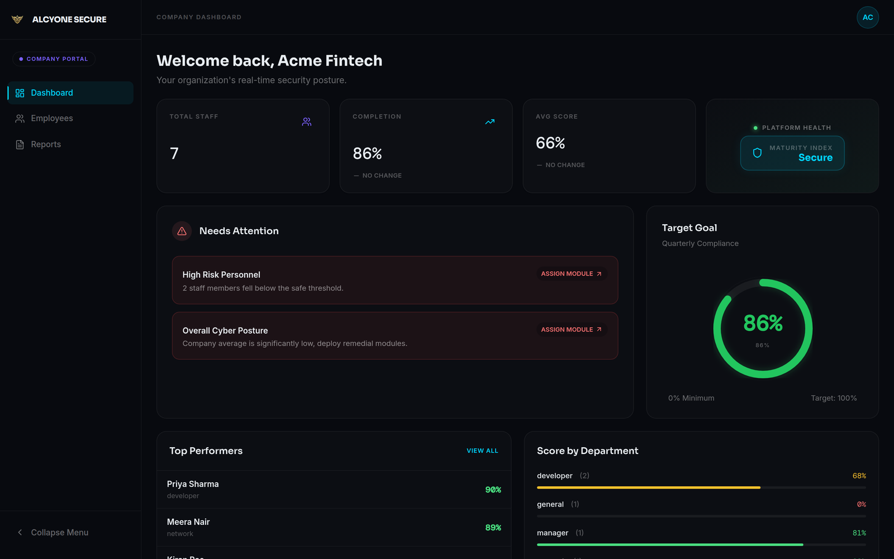
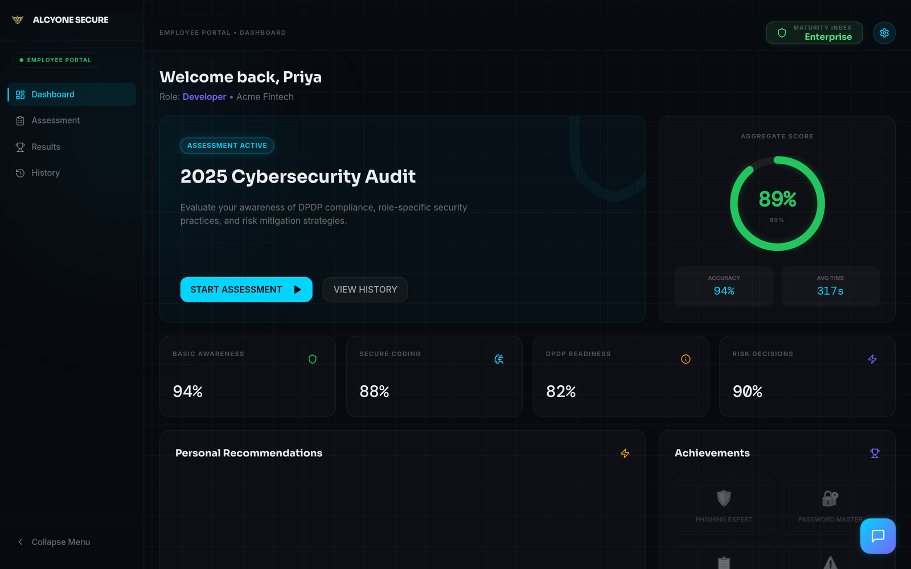
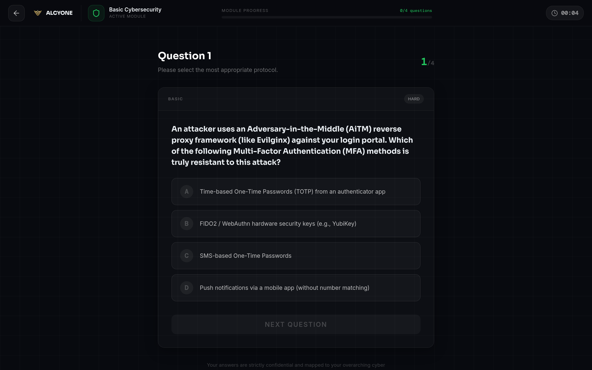
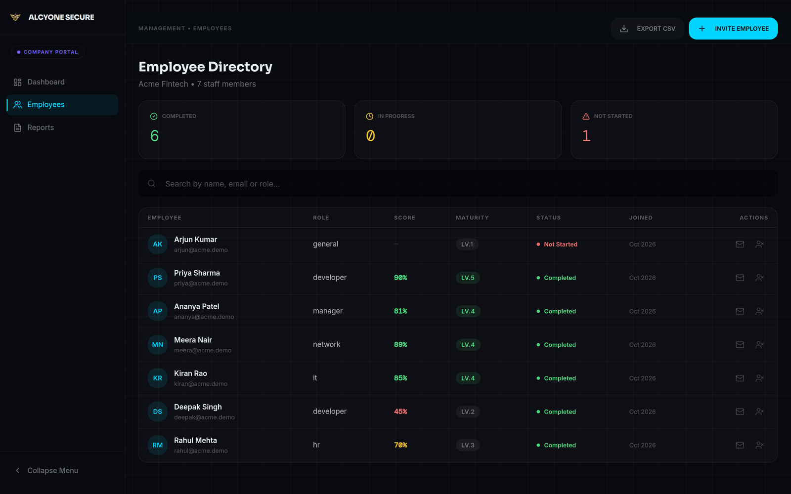
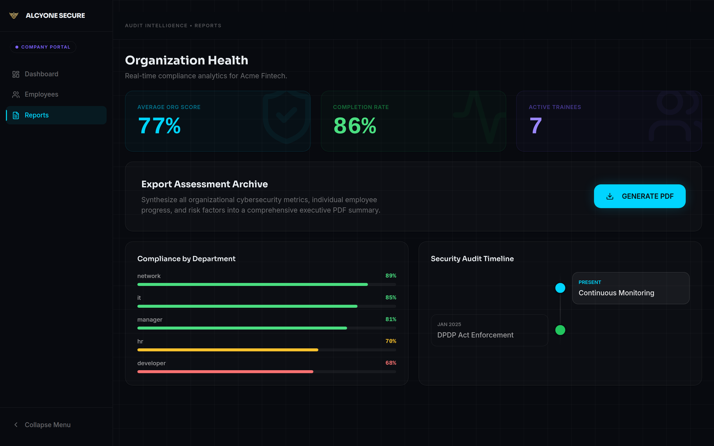
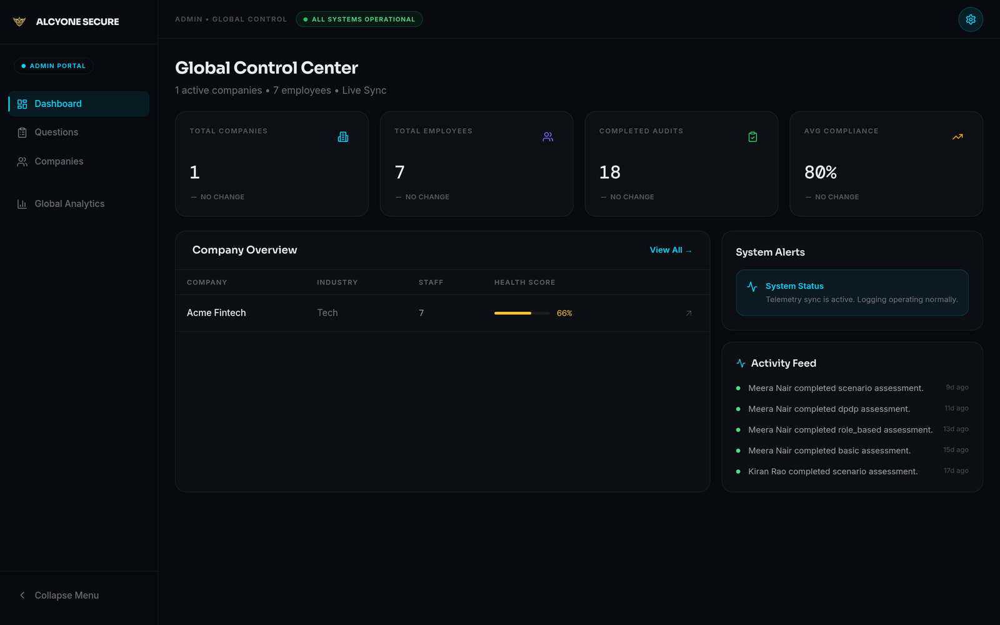
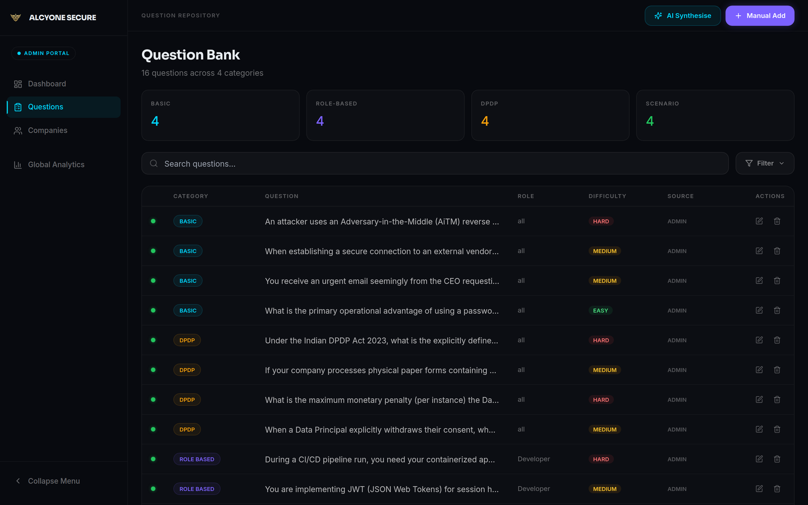
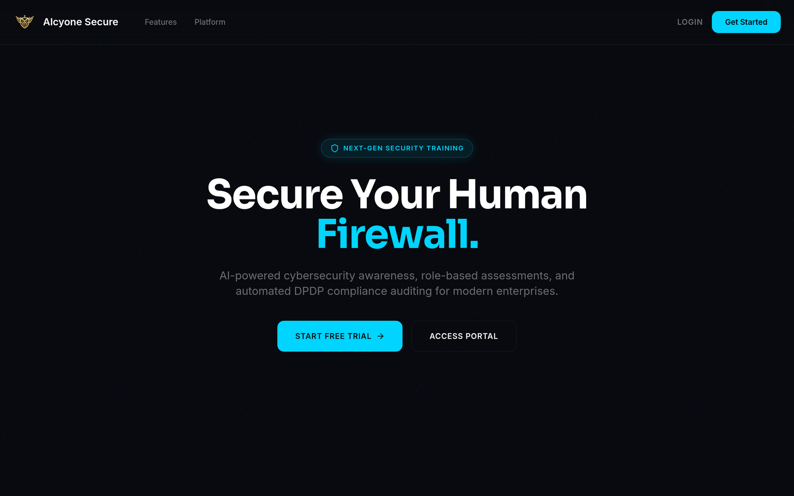
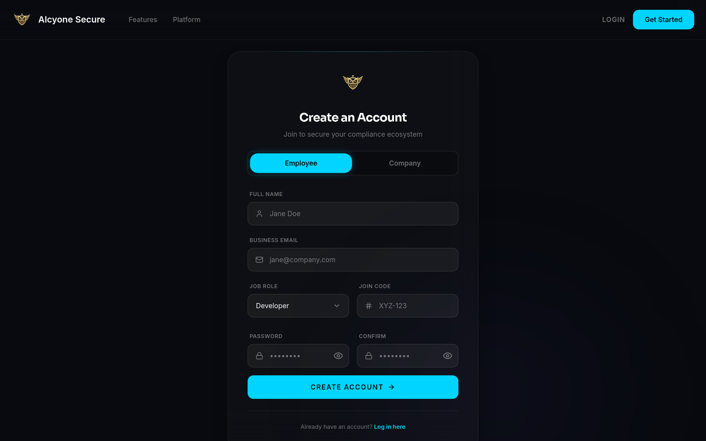

<div align="center">

# Risk Awareness Platform

**Security awareness and DPDP compliance assessments for companies and their employees, with an AI tutor and dashboards for every role.**

[](https://github.com/sathvik-zoldyck/risk-awareness-platform/actions/workflows/ci.yml)
[](https://github.com/sathvik-zoldyck/risk-awareness-platform/actions/workflows/rules.yml)
[](LICENSE)
[](https://github.com/sathvik-zoldyck/risk-awareness-platform/stargazers)

[Try it locally](#try-it-locally) · [Features](#features) · [Screenshots](#screenshots) · [Set up your own](#set-up-your-own) · [Contributing](CONTRIBUTING.md)



</div>

## What it does

Companies sign up, invite employees with a join code, and see how ready their people are: who has completed training, average scores, who needs attention and how each department is doing. Employees take short assessments on everyday security, their own role, India's **Digital Personal Data Protection (DPDP) Act** and real-world scenarios, and get explanations from an AI tutor as they go.

## Try it locally

You can run the whole platform on your machine with demo data, without creating a Firebase project:

```bash
git clone https://github.com/sathvik-zoldyck/risk-awareness-platform.git
cd risk-awareness-platform
npm install
npm run dev:demo
```

This needs [Java 11+](https://adoptium.net/) for the Firebase emulators. Open http://localhost:9002 and sign in with a demo account (password `demo-password`):

| Role | Email | Sees |
|---|---|---|
| Company | `security@acme.demo` | Company dashboard, employees, reports |
| Employee | `priya@acme.demo` | Assessments, results, history |
| Admin | `admin@demo.local` | All companies, question bank, platform settings |

These accounts exist only inside the local emulators. The AI features need a Gemini key ([see below](#ai-features-gemini)); everything else works without one.

## Features

**For employees**
- Four assessment modules: Basic Cybersecurity, Role-Based Security, DPDP Compliance and Scenario Thinking
- An AI tutor that explains each answer, and personal recommendations based on results
- A DPDP chatbot for questions about the 2023 Act
- Results, maturity level (1 to 5), history and a downloadable PDF certificate

**For companies**
- Invite employees with a join code
- Completion, average score, maturity index and people who need attention
- Scores by department and role, top performers, and PDF reports

**For platform admins**
- All companies and their employees
- A question bank with AI-assisted question drafting
- Platform-wide settings and reports

**Security**
- Role-based access enforced by [Firestore rules](firestore.rules): nobody can make themselves an admin, join codes cannot be listed, and each company only sees its own people
- 28 automated rules tests run against the Firestore emulator on every change

## Screenshots

| | |
|---|---|
|  **Employee dashboard** |  **Taking an assessment** |
|  **Company: employees** |  **Company: reports** |
|  **Admin dashboard** |  **Admin: question bank** |
|  **Landing page** |  **Sign up** |

## Set up your own

### Firebase

1. Create a project in the [Firebase console](https://console.firebase.google.com) and add a **Web app**.
2. Copy `.env.example` to `.env.local` and fill in the `NEXT_PUBLIC_FIREBASE_*` values.
3. **Authentication** → Sign-in method → enable **Email/Password**. Create a **Firestore** database.
4. Deploy the security rules:
   ```bash
   npx firebase login
   npx firebase use <your-project-id>
   npx firebase deploy --only firestore:rules
   ```
5. `npm run dev` and open http://localhost:9002.

### Create the first admin

Admins can't be created from the app, on purpose. Sign up once as a company or employee, then in the Firebase console open **Firestore → users → your user id** and set `role` to `admin`.

### Load the question bank

Sign in as the admin, open **Settings**, and choose **Seed Default Database Questions** to load the default questions, or write your own under **Questions**.

### AI features (Gemini)

Get a key from [Google AI Studio](https://aistudio.google.com/apikey) and set `GOOGLE_API_KEY` in `.env.local`. It is only used on the server: never prefix it with `NEXT_PUBLIC_`. Put a quota on the key; see [SECURITY.md](SECURITY.md).

### Deploy

Any Node.js host works (`npm run build && npm start`). On Vercel, import the repo and add the same environment variables. Firebase App Hosting is supported through `apphosting.yaml`.

## Tech stack

| | |
|---|---|
| App | Next.js 15 (App Router), React 19, TypeScript |
| UI | Tailwind CSS, Radix UI, Lucide icons |
| Data | Firebase Authentication and Firestore |
| AI | Genkit with Gemini 2.5 Flash |
| Reports | jsPDF |
| Tests | `@firebase/rules-unit-testing` on the Firestore emulator |

```
src/
├── ai/flows/      Answer explanations, DPDP chatbot, recommendations, question drafting
├── app/           admin/, company/, employee/, legal/, login, signup
├── components/    UI components
├── firebase/      Firebase setup, emulator support, data hooks
└── lib/           Types and the default question bank
tests/             Firestore security rules tests
scripts/           Demo data for the local emulators
```

## Development

```bash
npm run dev:demo     # app + emulators + demo data
npm run typecheck    # TypeScript
npm run test:rules   # security rules tests (Java 11+)
npm run build        # production build
```

## Contributing

Questions for the bank, translations, accessibility fixes and new assessment modules are all welcome. See [CONTRIBUTING.md](CONTRIBUTING.md). Report security issues privately, as described in [SECURITY.md](SECURITY.md).

## License

[MIT](LICENSE) © Alcyone Secure

If this helps your team, a ⭐ helps others find it.
